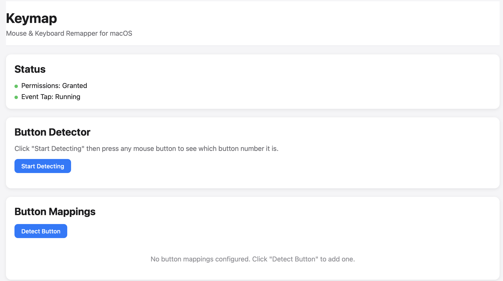

# Publishing Checklist for GitHub

This document outlines the steps to publish Keymap on GitHub.

## ✅ Completed Preparations

The following changes have been made to prepare your repository for publication:

### Security & Privacy
- ✅ Removed personal username and file paths from all documentation
- ✅ Fixed CORS security to restrict access to localhost only
- ✅ No API keys, secrets, or credentials in codebase

### GitHub Best Practices
- ✅ Added MIT License
- ✅ Added CONTRIBUTING.md with contribution guidelines
- ✅ Added GitHub issue templates (bug reports & feature requests)
- ✅ Enhanced README with badges, table of contents, and quick start
- ✅ All documentation uses generic paths

### Testing
- ✅ Backend imports successfully
- ✅ Application still runs locally

## 📋 Next Steps to Publish

### 1. Take a Screenshot
Replace the placeholder in README.md with an actual screenshot:
```bash
# Run the app and take a screenshot of the web UI
./run.sh
# Take a screenshot and save it as screenshot.png in the repo
```

Then update README.md line 10:
```markdown

```

### 2. Update GitHub URLs
Before publishing, update these placeholders in the following files:
- `README.md`: Replace `YOUR_USERNAME` with your GitHub username
- `.github/ISSUE_TEMPLATE/config.yml`: Update the discussions URL

**Files to update:**
```bash
# Find all instances
grep -r "YOUR_USERNAME" .
```

### 3. Create GitHub Repository
1. Go to https://github.com/new
2. Create a new repository named "keymap"
3. Choose "Public" visibility
4. Do NOT initialize with README (you already have one)
5. Click "Create repository"

### 4. Push to GitHub
```bash
# Add all changes
git add .

# Commit the changes
git commit -m "Prepare repository for public release

- Remove personal information from documentation
- Add MIT license
- Add contribution guidelines and issue templates
- Enhance README with badges and better structure
- Fix CORS security to localhost only"

# Add remote (replace YOUR_USERNAME)
git remote add origin https://github.com/YOUR_USERNAME/keymap.git

# Push to GitHub
git branch -M main
git push -u origin main
```

### 5. Configure GitHub Repository Settings

After pushing, configure your repository on GitHub:

1. **Add Topics/Tags**:
   - Go to repository → About (settings gear)
   - Add topics: `macos`, `mouse-remapper`, `keyboard-shortcuts`, `python`, `flask`, `react`, `accessibility`

2. **Enable Discussions** (optional):
   - Settings → Features → Check "Discussions"

3. **Set Repository Description**:
   - "A simple, powerful tool to remap mouse buttons and keyboard shortcuts on macOS with per-application support"

4. **Add Website** (if you have one):
   - Settings → About → Website URL

### 6. Create a Release (Optional)

Create your first release:
```bash
# Tag the current commit
git tag -a v1.0.0 -m "Initial public release"
git push origin v1.0.0
```

Then on GitHub:
1. Go to Releases → Create a new release
2. Choose tag `v1.0.0`
3. Title: "v1.0.0 - Initial Release"
4. Description:
   ```markdown
   ## Features
   - Remap mouse buttons to clicks, keystrokes, or ignore
   - Per-application context support
   - Web-based configuration UI
   - Button detection mode
   - Hot reload configuration

   ## Installation
   See [README.md](README.md) for detailed installation instructions.
   ```

### 7. Test the Installation Instructions

Clone your repository in a different location and test the installation:
```bash
cd /tmp
git clone https://github.com/YOUR_USERNAME/keymap.git
cd keymap
# Follow the installation steps in README.md
```

### 8. Share Your Project

Once published, you can share on:
- Reddit: r/macapps, r/Python
- Hacker News
- Twitter/X
- Product Hunt (for more exposure)

## 📝 Ongoing Maintenance

After publishing:
- Respond to issues and pull requests
- Keep dependencies updated
- Add new features based on user feedback
- Update documentation as needed

## 🔒 Security Notes

Your local installation will continue to work normally. The changes made:
- Your local paths still work (scripts detect the current directory)
- CORS is now restricted to localhost for security
- Application functionality is unchanged

## Questions?

If you have any questions about the publishing process, feel free to ask!
